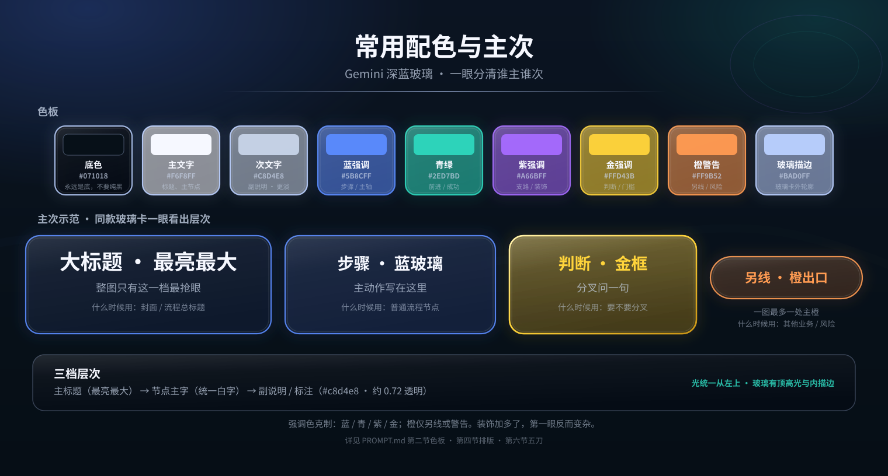
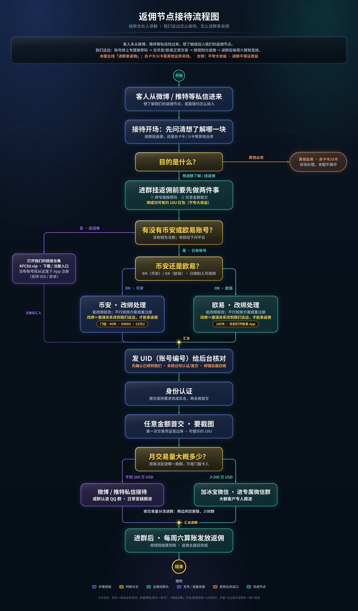

# 出图美术标准（Gemini 深蓝玻璃光效）

一套给 Grok Bot、文生图和程序化 SVG 共用的美术提示词与硬规矩。

覆盖信息图、日报卡、推特复盘、数据海报，以及必须分叉汇合的流程图。

## 怎么用

1. 打开 [PROMPT.md](./PROMPT.md)。
2. 先看「选通道」：密中文流程图只用程序化，不要文生图赌字。
3. 文生图：复制主提示词 + 单独贴否定提示词，末尾补主题和画幅。
4. 程序化：按色板、光向、玻璃层、排版硬规矩画；流程图再遵守专规。
5. 改图时优先做「最容易立刻变好看的五刀」，再堆装饰。
6. 对照检查清单，尤其是内边距、重叠、缩略图能否认路。
7. 配色拿不准时，先打开下面的配色参考图，对照色块和主次示范。

## 文件

| 文件 | 说明 |
|---|---|
| [PROMPT.md](./PROMPT.md) | 完整标准：通道、主/否定提示词、色板、光与玻璃、排版、流程图、五刀优先级、检查清单 |
| [palette-hierarchy.png](./palette-hierarchy.png) | 常用配色与主次参考图（色块 + HEX + 什么时候用 + 主次示范卡） |
| [palette-hierarchy.svg](./palette-hierarchy.svg) | 同上 SVG 源 |
| [palette-hierarchy-preview.jpg](./palette-hierarchy-preview.jpg) | 聊天预览用 JPG |
| [samples/rebate-flow-v11-preview.jpg](./samples/rebate-flow-v11-preview.jpg) | 按本标准落地的返佣节点接待流程图示例 |
| README.md | 本说明 |

## 配色参考图

一眼能看到：底 / 主字 / 次字 / 蓝 / 青 / 紫 / 金 / 橙 / 玻璃描边，以及大标题、步骤蓝卡、判断金卡、另线橙出口谁主谁次。

## 示例流程图

按本标准程序化 SVG 出的竖向真流程图：分叉汇合、语义配色、量字定框、零重叠。

## 风格一句话

Gemini 发布会同款深空蓝与玻璃光；字大、不贴边、不重叠；层次少而清楚；装饰克制。
